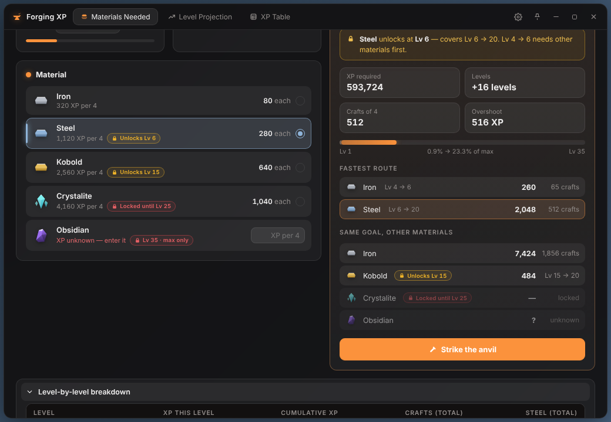
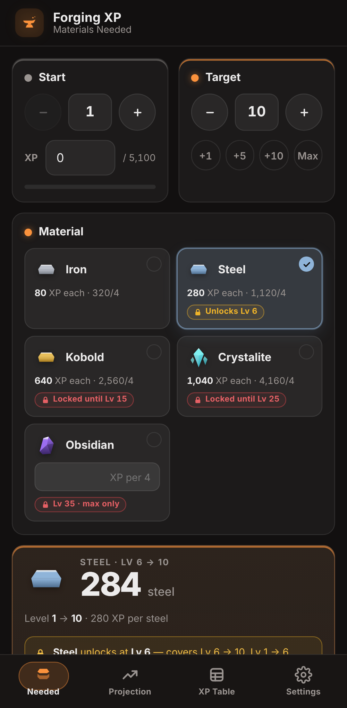
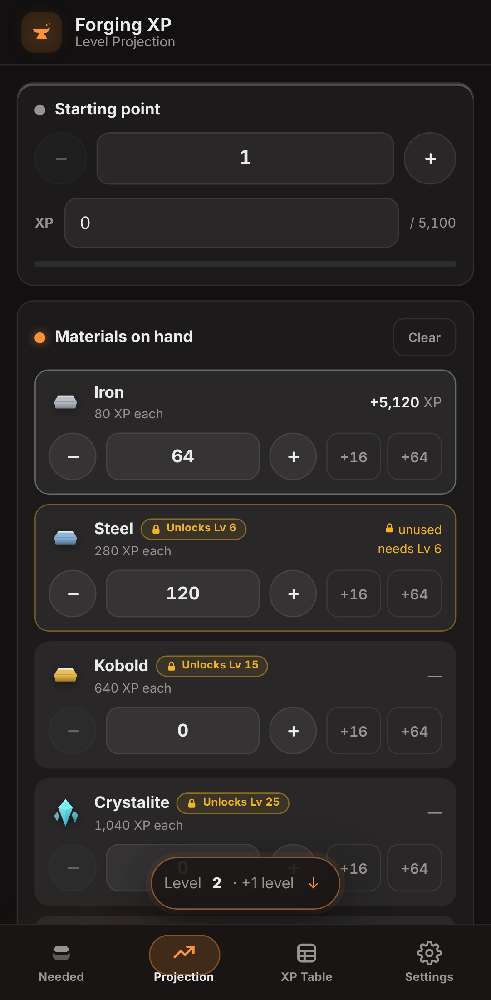
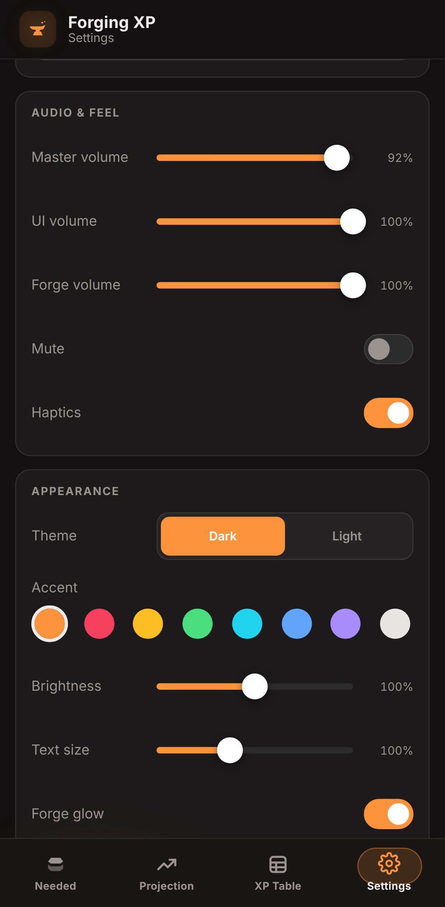

# Forging XP Calculator — Project Eternity

A blacksmithing XP calculator for the Roblox game **Project Eternity**, available as a
**Windows desktop app** and an **Android app**. It tells you how much material you need to reach a
level, how far the materials you already have will take you, and the fastest route through the
material unlocks.

<p align="center">
  
</p>
<p align="center">
  
  
  
</p>

## Download

Grab the latest build from the **[Releases](../../releases)** page. See what changed in each version (desktop and mobile) in the **[Changelog](CHANGELOG.md)**.

| Platform | File | Notes |
|---|---|---|
| Windows 10/11 | `ForgingXpCalculator.exe` | Single file. Uses the WebView2 runtime that ships with Windows. |
| Android 7.0+ | `ForgingXP.apk` | Sideload: open the file on your phone and allow *Install unknown apps*. |

Every push to `main` is also built automatically by GitHub Actions; the latest builds are under
**Actions → Build → Artifacts**.

### Publishing a new release

Push a version tag and GitHub builds both apps and publishes the release automatically:

```bash
git tag v1.2.0
git push origin v1.2.0
```

(or run **Actions → Release → Run workflow**). For the APK to install over an existing copy, CI has
to sign it with the project key. Add two repository secrets under
**Settings → Secrets and variables → Actions**:

- `ANDROID_KEYSTORE_B64`: your `forgingxp.keystore`, base64-encoded
  (PowerShell: `[Convert]::ToBase64String([IO.File]::ReadAllBytes("forgingxp.keystore")) | Set-Clipboard`)
- `ANDROID_KEYSTORE_PASSWORD`: the keystore password

Without them the release APK is signed with a temporary key.

## Features

- **Materials Needed**: pick a start level (plus current XP) and a target level and see exactly how
  many items and crafts you need, with overshoot, progress across levels 1–35, and the same goal in
  every other material.
- **Fastest route**: automatically uses the best material unlocked at each stage
  (Iron → Steel → Kobold → Crystalite).
- **Level Projection**: enter what you have (one material or several) and see the level you'll
  reach, progress into it, each material's share of the XP, and what you need for the next level.
  Materials that aren't unlocked yet are only used once you reach their level.
- **XP Table**: the full curve. Click or tap a row to set your target, Shift-click or hold to set
  your start.
- **Crafting-accurate rounding**: crafts consume 4 items at a time, so every count is a whole
  number of crafts (a multiple of 4), and leftover items are flagged as spare.
- Synthesized sound effects, animations, dark/light themes, accent colours, brightness, and
  editable material values and unlock levels.
- **Desktop**: frameless window with edge resizing, true window transparency, always-on-top, and
  a window that always fits on screen.
- **Mobile**: swipe between tabs, a bottom navigation bar, haptics, hold-to-repeat steppers, and
  sliders that only move when you drag them sideways, so scrolling never changes a setting.

## How the math works

Blacksmithing is a **skill stat** (like cooking and fishing), so it uses the steeper skill curve
scaled by `XP_REQUIREMENT_MULTIPLIER = 3.4`:

```
XP to go from level L to L+1  =  floor( (1500 + 400·n + 40·n²) × 3.4 ),   n = L − 1
Max level 35  ·  2,640,304 total XP from level 1
```

| Material | XP per 4 items | XP each | Unlocks at |
|---|---:|---:|---:|
| Iron | 320 | 80 | Lv 1 |
| Steel | 1,120 | 280 | Lv 6 |
| Kobold | 2,560 | 640 | Lv 15 |
| Crystalite | 4,160 | 1,040 | Lv 25 |
| Obsidian | unknown | — | Lv 35 (max) |

All values (XP and unlock levels) can be edited in **Settings** if the game changes them.

## Building from source

### Desktop (Windows)

Requirements:
- [Rust](https://rustup.rs) (stable)
- Windows 10/11 with the Microsoft Edge **WebView2 runtime** (pre-installed on current Windows)
- To build on Windows natively: the MSVC toolchain (Visual Studio Build Tools, "Desktop development with C++")

```powershell
cd desktop
cargo build --release
# -> desktop\target\release\ForgingXpCalculator.exe
```

With the default MSVC toolchain the WebView2 loader is linked statically, so the `.exe` is all you
need.

**Cross-compiling from Linux** (how the release builds were made):

```bash
rustup target add x86_64-pc-windows-gnu
sudo apt install gcc-mingw-w64-x86-64      # linker + windres
cd desktop
cargo build --release --target x86_64-pc-windows-gnu
```

The GNU target links WebView2 dynamically, so ship `WebView2Loader.dll` next to the `.exe`. You'll
find it in your cargo registry under `webview2-com-sys-*/x64/WebView2Loader.dll`.

### Android

Requirements:
- JDK 17 or newer
- Android SDK with **platform `android-34`** and **build-tools `35.0.0`**
  (`sdkmanager "platforms;android-34" "build-tools;35.0.0"`)
- `ANDROID_HOME` pointing at the SDK
- `bash` and `zip` (on Windows, use Git Bash or WSL)

```bash
bash mobile/android/build.sh
# -> mobile/android/ForgingXP.apk
```

The script builds without Gradle (`aapt2 → javac → d8 → zipalign → apksigner`). It creates a local
signing key (`forgingxp.keystore`) the first time. **Keep that file and never commit it**: Android
only installs an update over an existing install if it's signed with the same key. You can override
the SDK packages with `BUILD_TOOLS=… PLATFORM=… bash mobile/android/build.sh`.

To preview the mobile UI without a phone, open `mobile/www/index.html` in Chrome with device
emulation (DevTools → toggle device toolbar).

## Project layout

```
desktop/
  src/main.rs        Rust shell (tao + wry/WebView2): frameless window, resizing, opacity, persistence
  ui/                HTML / CSS / JS user interface (embedded into the .exe at build time)
  assets/            icon + Windows version resource
mobile/
  www/               mobile HTML / CSS / JS user interface
  android/           Java WebView shell (storage, haptics, back button, system bars) + build script
docs/screenshots/
.github/workflows/   CI: builds the .exe and .apk on every push
```

## Where settings are stored

- **Windows**: `%APPDATA%\ForgingXpCalculator\` (`settings.json`, `window.json`)
- **Android**: private app storage (cleared if you uninstall the app)

## Disclaimer

Fan-made tool. Not affiliated with or endorsed by the developers of Project Eternity or by Roblox
Corporation. Game values may change; edit them in Settings.

## License

[MIT](LICENSE)
